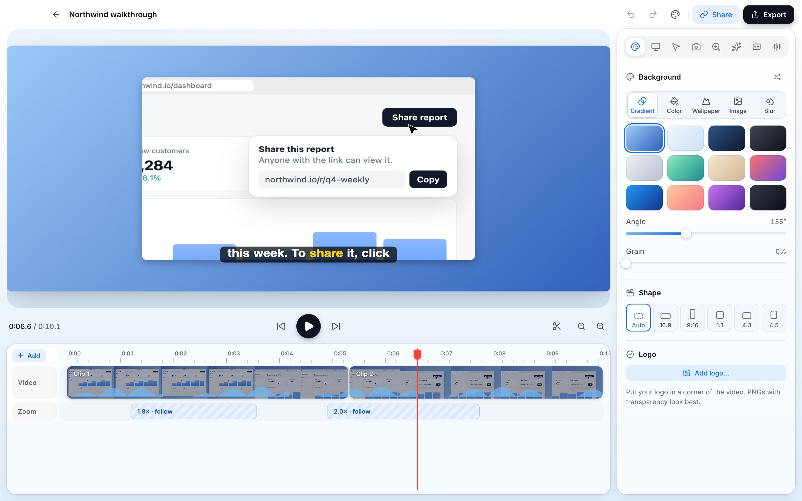

<p align="center">
  
</p>

<h1 align="center">Umi</h1>

<p align="center">
  The free screen recorder for people who explain things.<br>
  Record, edit with auto-zoom and captions, and share a link — on macOS, Windows, Linux and the web.
</p>

<p align="center">
  <a href="https://umi.cam">Website</a>
  ·
  <a href="https://umi.cam/#download">Download</a>
  ·
  <a href="https://umi.cam/#pricing">Pricing</a>
  ·
  <a href="https://github.com/huseyinsezeryildirim/umi/issues">Report a bug</a>
</p>

<p align="center">
  <a href="LICENSE"></a>
  
  <a href="https://github.com/huseyinsezeryildirim/umi/actions/workflows/ci.yml"></a>
</p>



Umi is an open-source alternative to Loom and Screen Studio. Record your screen, camera and voice;
Umi turns it into a polished video with smooth zooms that follow your cursor, captions, a styled
background and a camera bubble; then export the file or share a link that people can watch,
comment on and react to.

Everything that runs on your computer is free, with no watermark and no time limit, including for
work. That includes the AI: captions, filler-word removal, voiceover, noise and background removal
and titles all run on your device. You only pay when we host things for you.

## Why Umi

- **Record anything.** A screen, a window or an area, with camera, microphone and system sound. A camera bubble you can resize, reshape and turn off mid-recording; draw on screen while you talk.
- **Looks edited, without editing.** Auto-zoom that follows your clicks, smooth cursor, click highlights, backgrounds, padding, shadows and device frames.
- **Edit like a doc.** Delete words in the transcript to cut the video; remove “um”s and long pauses in one click; speed up typing; split, trim and combine takes.
- **AI on your device.** Captions in 90+ languages, voiceover from a script, noise and echo removal, camera background blur or removal, face tracking, and titles from what you said and what was on screen. Nothing leaves your computer.
- **Share in seconds.** A link that's copied before the upload finishes, with comments, reactions, viewer insights, passwords, expiry dates and embeds.
- **Bring your Loom videos.** Paste Loom links and they become Umi projects you can edit — free.
- **Everywhere, the same.** One editor and one renderer on macOS, Windows, Linux and in the browser.

## Free and Pro

| | Free | Pro |
|---|---|---|
| Recording, editing, 4K and GIF export | ✓ unlimited | ✓ unlimited |
| On-device AI (captions, voiceover, clean-up) | ✓ | ✓ |
| Commercial use, no watermark | ✓ | ✓ |
| Share links | 3 at a time, up to 5 min, kept 7 days | unlimited, up to 4 hours each, 200 GB |
| Viewer insights, passwords, your own domain | | ✓ |

## Get started

1. Download Umi for your system from [umi.cam](https://umi.cam/#download), or open it [in your browser](https://umi.cam/app).
2. Pick what to record and press Start (or ⌥⇧L / Alt+Shift+L from any app).
3. Stop, and the editor opens with your recording already styled. Export the file, or press Share for a link.

## Develop

```bash
pnpm install
pnpm dev                      # the desktop app (tauri dev)
pnpm --filter @umi/site dev   # the website on http://localhost:3210
cargo test --workspace --release
```

Service keys baked into builds (Pexels) come from the environment or a git-ignored
`keys.env` at the repository root (`UMI_PEXELS_KEY=…`).

Cloud, locally: `cd web && npm run setup:local && npm run dev`, then `node scripts/e2e.mjs`.

`scripts/make-fixture.sh` builds a synthetic recording in `/tmp/umi-fixtures` for render tests.

## Layout

```
crates/
  umi-project   .umi project format, edit settings, captions, insights
  umi-render    wgpu compositor: background, cursor, zoom, camera, captions
  umi-media     FFmpeg decode/encode, audio, GIF, remux
  umi-engine    export, audio mix, voice clean-up, tracking
  umi-capture   screen/camera/mic/input capture per platform
  umi-recorder  a recording session (prepare, begin, pause, stop, recover)
  umi-ai        Whisper, Kokoro voice, segmentation, face detection
  umi-cloud     Umi Cloud client
  umi-mcp       MCP server for AI agents
apps/desktop    the app
apps/site       umi.cam
packages/ui     design system
web/            Umi Cloud
extension/      Chrome extension
docs/           product, architecture, roadmap
```

## Contributing

Issues and pull requests are welcome. Every change has to work on macOS, Windows, Linux and the web;
CI builds and tests all four.

## License

Umi is free software under the [GNU Affero General Public License v3.0](LICENSE). If you run a modified
version as a network service, you must offer its source to its users. The Umi name and logo are not
covered by the license.
